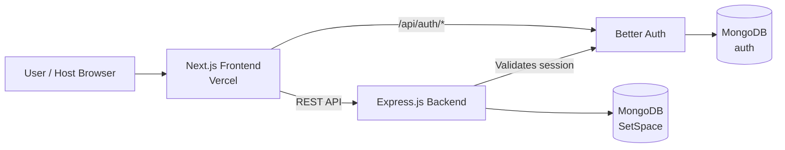

<div align="center">

# 🎬 SetSpace

### Creative Studio Rental Marketplace

**Discover. Book. Create.**

A modern full-stack marketplace connecting photographers, filmmakers, podcasters, musicians, and other creators with studios and creative spaces.

[](https://set-space-ten.vercel.app/)
[](https://github.com/mehrabislam00/Set-Space)
[](https://github.com/mehrabislam00/set-space-backend)

</div>

---

## 📑 Table of Contents

- [Overview](#-overview)
- [Live Demo](#-live-demo)
- [Features](#-features)
- [Tech Stack](#-tech-stack)
- [Architecture](#-architecture)
- [Project Structure](#-project-structure)
- [Getting Started](#-getting-started)
- [Environment Variables](#-environment-variables)
- [Available Scripts](#-available-scripts)
- [Deployment](#-deployment)
- [Project Scope](#-project-scope)
- [Roadmap](#-roadmap)
- [Repositories](#-repositories)

---

## 🌟 Overview

**SetSpace** makes finding and renting creative spaces simple. Renters can discover studios, explore facilities, check availability, and send booking requests. Hosts can list their spaces, set pricing and opening hours, and manage incoming requests, all from dedicated dashboards.

| 🎨 For Creators | 🏠 For Hosts |
| --- | --- |
| Search and filter studios | List and manage studios |
| Compare amenities, ratings, and hours | Set pricing, hours, and blackout dates |
| Request bookings in a few clicks | Accept or reject booking requests |
| Save favorites to a wishlist | Track performance and statistics |

## 🚀 Live Demo

👉 **[set-space-ten.vercel.app](https://set-space-ten.vercel.app/)**

<!-- Add screenshots here for a big visual boost:


-->

## ✨ Features

<details open>
<summary><b>🔍 Studio Discovery</b></summary>

- Browse all available creative studios
- Search by name and location
- Filter and sort listings
- Explore by creative category
- Detailed pages with photos, amenities, facilities, ratings, reviews, and opening hours
- Similar studio recommendations

</details>

<details open>
<summary><b>📅 Booking Management</b></summary>

- Submit booking requests with date and time-slot selection
- View booking details and status
- Track upcoming and past bookings
- Booking-related notifications

</details>

<details>
<summary><b>👤 User Dashboard</b></summary>

- Personalized dashboard and profile management
- Profile picture upload
- Booking history and upcoming bookings
- Wishlist of favorite studios
- Notification center
- Account and appearance preferences

</details>

<details>
<summary><b>🏢 Host Dashboard</b></summary>

- Create, edit, and publish studio listings
- Upload studio photographs
- Configure pricing and opening hours
- Manage availability and unavailable dates
- Review, accept, or reject booking requests
- Monitor studio performance and booking statistics

</details>

<details>
<summary><b>🔐 Authentication</b></summary>

- Email and password registration and login
- Google sign-in
- Secure session management with **Better Auth**
- Protected user and host routes

</details>

<details>
<summary><b>🎁 Extras</b></summary>

- Fully responsive UI
- Light and dark themes
- Smooth page transitions and animations
- FAQ and help sections
- Contact form and newsletter subscription
- Privacy policy and terms of service pages

</details>

## 🧰 Tech Stack

| Category | Technologies |
| --- | --- |
| **Framework** | Next.js 16 (App Router) |
| **UI Library** | React 19 |
| **Language** | TypeScript |
| **Styling** | Tailwind CSS 4 |
| **Components** | shadcn/ui, Base UI |
| **Icons** | Lucide React, React Icons |
| **Charts** | Recharts |
| **Theming** | next-themes |
| **Dates** | date-fns |
| **Code Highlighting** | Shiki |
| **Authentication** | Better Auth |
| **Backend** | Express.js 5 (REST API) |
| **Database** | MongoDB |
| **Deployment** | Vercel |

## 🏗 Architecture



### Frontend

- **App Router** for routing and layouts
- Feature-based component organization with shared UI primitives
- Custom hooks for reusable client logic
- API clients in `lib/` for backend communication
- Context providers for shared state

### Authentication

Better Auth runs inside the Next.js API route `/api/auth/[...all]` and supports email/password plus Google sign-in.

### Backend Communication

The frontend talks to a separate Express.js backend over REST. It handles:

| Domain | Domain |
| --- | --- |
| Studio management | Reviews |
| Booking requests | Wishlist |
| User profiles | Notifications |
| Dashboard statistics | Contact messages & newsletter |

### Databases

One MongoDB cluster, two databases:

| Database | Responsibility |
| --- | --- |
| `auth` | Better Auth users, sessions, accounts, verification records |
| `SetSpace` | Studios, bookings, reviews, profiles, wishlists, notifications |

The backend validates Better Auth sessions before processing protected operations.

## 📂 Project Structure

```text
Set-Space/
├── app/                    # Routes and layouts (App Router)
│   ├── (auth)/             # Authentication pages
│   ├── about/              # About page
│   ├── api/auth/           # Better Auth API handler
│   ├── contact/            # Contact page
│   ├── dashbord/           # User dashboard
│   ├── explore-studio/     # Studio exploration and details
│   ├── host/               # Host dashboard and management
│   ├── how-it-works/       # Platform workflow
│   ├── studios/            # Studio listings and details
│   ├── privacy/            # Privacy policy
│   ├── terms/              # Terms of service
│   ├── layout.tsx          # Root layout
│   └── page.tsx            # Homepage
├── assets/                 # Static assets and images
├── components/             # Feature-based UI components
│   ├── About/  Animation/  Auth/  Contact/  Dashboard/
│   ├── Explore studios/  Footer/  Host/  Home/  Navbar/
│   ├── Notifications/  Studio card/  Studio Detail/
│   ├── ui/                 # Reusable UI primitives
│   └── theme-provider.tsx
├── hooks/                  # Custom React hooks
├── lib/                    # API clients and utilities
│   ├── auth.ts / auth-client.ts
│   ├── Booking-api.ts      ├── Marketplace-api.ts
│   ├── Studio-api.ts       ├── Studio-store.ts
│   ├── Dashboard-data.ts   ├── Host-data.ts
│   └── utils.ts
├── public/                 # Public static files
├── components.json
├── next.config.ts
├── package.json
└── tsconfig.json
```

## ⚡ Getting Started

### Prerequisites

- Node.js (a version supported by Next.js 16)
- npm
- Git
- A MongoDB Atlas account
- Google OAuth credentials *(optional, only for Google sign-in)*

### 1. Clone and install

```bash
git clone https://github.com/mehrabislam00/Set-Space.git
cd Set-Space
npm install
```

### 2. Configure environment

Create a `.env.local` file in the project root (see [Environment Variables](#-environment-variables)).

### 3. Start the backend

```bash
git clone https://github.com/mehrabislam00/set-space-backend.git
cd set-space-backend
npm install
# configure .env as documented in the backend repository
npm run dev
```

The backend runs at `http://localhost:5000`.

### 4. Start the frontend

In a new terminal, from the frontend directory:

```bash
npm run dev
```

Open **http://localhost:3000** 🎉

## 🔑 Environment Variables

Create `.env.local` in the project root:

| Variable | Required | Description |
| --- | :---: | --- |
| `BETTER_AUTH_MONGO_URI` | ✅ | MongoDB connection string (auth database is named `auth`) |
| `BETTER_AUTH_URL` | ✅ | Frontend base URL, e.g. `http://localhost:3000` |
| `NEXT_PUBLIC_API_URL` | ✅ | Backend API URL, e.g. `http://localhost:5000` |
| `MONGODB_USERNAME` | ➖ | Only if your connection URI requires it |
| `MONGODB_PASSWORD` | ➖ | Only if your connection URI requires it |
| `GOOGLE_CLIENT_ID` | ➖ | Required only for Google sign-in |
| `GOOGLE_CLIENT_SECRET` | ➖ | Required only for Google sign-in |

```env
BETTER_AUTH_MONGO_URI=your_mongodb_connection_string
BETTER_AUTH_URL=http://localhost:3000
NEXT_PUBLIC_API_URL=http://localhost:5000

# Optional
MONGODB_USERNAME=your_mongodb_username
MONGODB_PASSWORD=your_mongodb_password
GOOGLE_CLIENT_ID=your_google_client_id
GOOGLE_CLIENT_SECRET=your_google_client_secret
```

> [!IMPORTANT]
> - Use your own credentials and keep them private.
> - **Never commit `.env.local`** to GitHub.
> - Frontend and backend must use the same MongoDB cluster and a compatible authentication configuration.

## 📜 Available Scripts

| Command | Description |
| --- | --- |
| `npm run dev` | Start the development server |
| `npm run build` | Create a production build |
| `npm run start` | Start the production server |
| `npm run lint` | Run ESLint |
| `npm run typecheck` | Run TypeScript checks |
| `npm run format` | Format project files |

## ☁️ Deployment

The frontend is deployed on **Vercel**.

1. Import the frontend repository into Vercel.
2. Add the required environment variables.
3. Set `NEXT_PUBLIC_API_URL` to the deployed backend URL.
4. Set the backend's `CLIENT_URI` to allow the production frontend origin.
5. Set `BETTER_AUTH_URL` to the production frontend URL.
6. Ensure both apps share the same auth database and compatible session configuration.
7. Deploy both apps and verify API communication.

## 📌 Project Scope

SetSpace currently supports studio discovery, booking requests, host management, user dashboards, and related marketplace features.

> [!NOTE]
> Booking requests and status management are implemented. **Online payment gateway integration is not currently included.**

## 🗺 Roadmap

- [x] Studio discovery, search, and filtering
- [x] Booking requests and status management
- [x] User and host dashboards
- [x] Email/password and Google authentication
- [x] Reviews, wishlist, and notifications
- [ ] Online payment gateway integration
- [ ] Automated end-to-end testing
- [ ] Advanced booking and availability management
- [ ] Additional marketplace analytics
- [ ] Further UX improvements

## 🔗 Repositories

| Project | Link |
| --- | --- |
| 🌐 Live Website | [set-space-ten.vercel.app](https://set-space-ten.vercel.app/) |
| 💻 Frontend | [mehrabislam00/Set-Space](https://github.com/mehrabislam00/Set-Space) |
| ⚙️ Backend API | [mehrabislam00/set-space-backend](https://github.com/mehrabislam00/set-space-backend) |

---

<div align="center">

**SetSpace — Create. Rent. Inspire.**

Built with passion for the creative community. ⭐ Star the repo if you like it!

</div>
